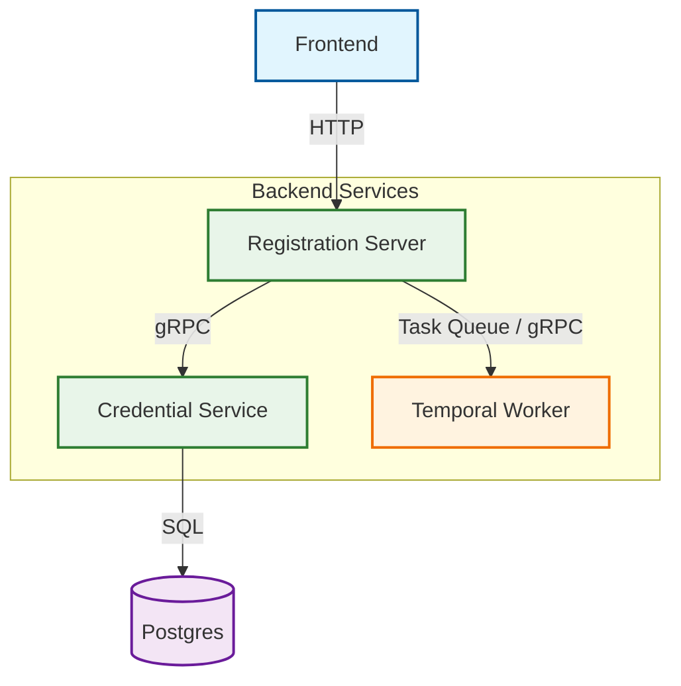

# Specification: Go Registration System

## Overview
- **Purpose:** Create a Sign Up and Sign In system to learn and practice Golang, Temporal Workflow and gRPC.

## Goals
- User signs up with **email** and **password**
- System creates a pending registration and emails a 6-digit code
- User enters the code:
    - correct → account active, success page
    - wrong too many times → registration locked
    - lost / expired → user requests a new code
- Active user logs in, receives an access token, views profile
- Never verified → registration expires after 24h, cleaned up, email can register again

## Architecture

**Component List**
- **Registration Server:** Public HTTP API, UI, prospect lifecycle
- **Credential Service:** Internal gRPC, password hashing + verification
- **Temporal Worker:** Registration workflow, email, expiry

## Use Cases
| |	Use case | Rules |
| --- | --- | --- |
|UC1 | Register	Email + password policy validation.| No account enumeration. |
UC2	| Verify email	| 6-digit OTP, TTL 15m, max 5 attempts | 
UC3	| Resend OTP	| Invalidate previous OTP, rate-limited |
UC4	| Log in	| Active accounts only, JWT/PASETO |
UC5	| Get profile	| Auth middleware |
UC6	| Expire registrations	| Pending > 24h → expired, cleanup|

Prospect status: pending → verified → active / expired / locked

## Technical Design
### List of endpoints:
- POST /signup
- POST /signin
- POST /resendotp
- POST /verifyotp
- GET /userprofile

### Database Schema:
Will be added later

## POC Flows

#### Sign up POC Flow
    1) User fills in email + password on Frontend and clicks Submit.
    2) Frontend sends POST /signup to Registration Server (HTTP).
    3) Registration Server calls Credential Service via gRPC to securely hash the password.
    4) Credential Service hashes the password and returns the hash via gRPC.
    5) Registration Server saves the pending registration with the hash into Postgres.
    6) Registration Server triggers the email workflow (generates/sends OTP).
    7) Registration Server returns 201 Created / success response to Frontend.
    8) Frontend displays the "Enter your 6-digit OTP" 
#### OTP POC Flow
    1) User fills in OTP and clicks Submit
    2) Frontend sends POST /verifyotp to Registration Service.
    3) Registration Service verify the OTP:
        a) If status is locked or expired: return 400 Bad Request.
        b) If OTP matches and is within 15 min:
            ▪ Transition status: pending → verified → active.
            ▪  Return 200 OK (with success message).
        c) If OTP is incorrect or expired:
                • Increment attempts.
                •  If attempts >= 5: set status to locked.
                • Return 400 Bad Request (e.g., "Invalid code. 3 attempts remaining" or "Account locked").
#### Sign in POC FLow
    1) User fills in email + password and clicks Submit.
    2) Frontend sends POST /signin to Registration Server.
    3) Registration server checks if the account is active (reject if status is pending / locked / expired)
    4) Registration Server calls Credential Server via gRPC.
    5) Credential Server compares and verifies password and hash
    6) Registration Server creates a signed JWT
    7) Registration Server returns 200 OK and JWT to Frontend.
    8) Frontend saves JWT to LocalStorage
    9) Frontend redirects to profile page

#### Get profile POC FLow
    1) Frontend redirects to profile page after signing in
    2) Frontend sends a GET /getprofile request with authorisation header.
    3) Registration Server's Auth Middleware intercepts the request::
        a) Validate JWT signature and expiry.
        b) Extracts userID/email from claims and attaches it to Request
    4) Handler get user profile from database
    5) Registration Server returns user information and 200 OK response to Frontend.
