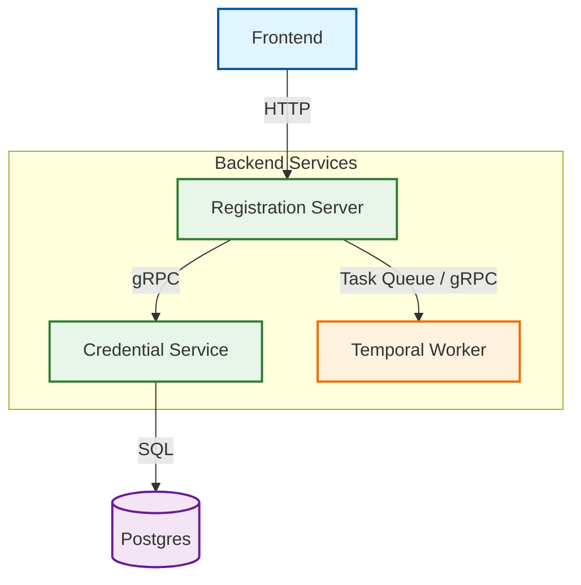
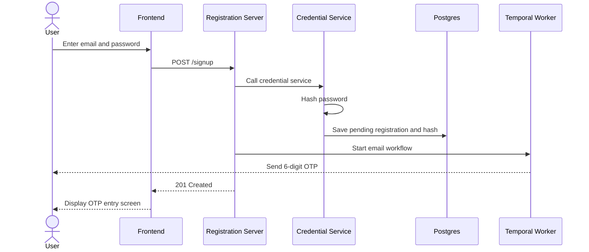
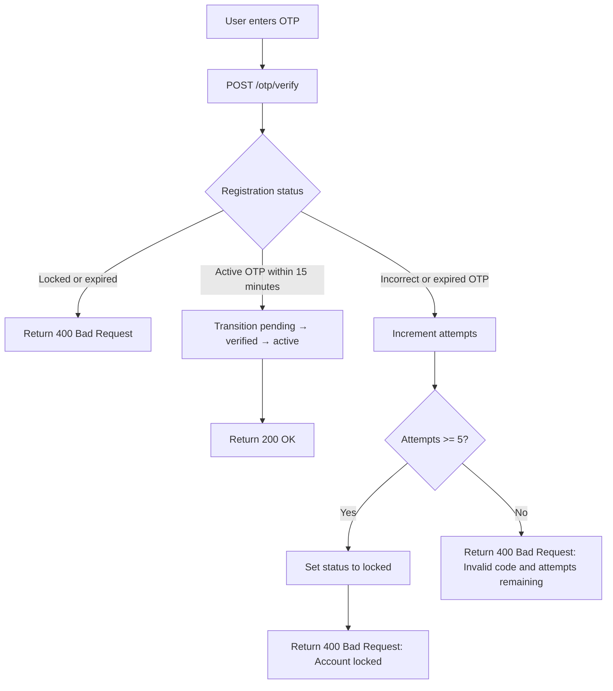
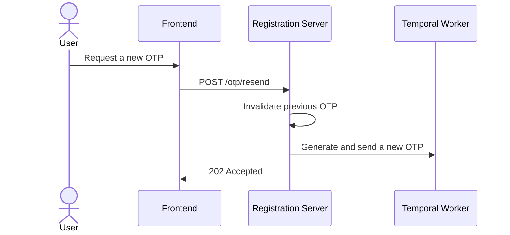
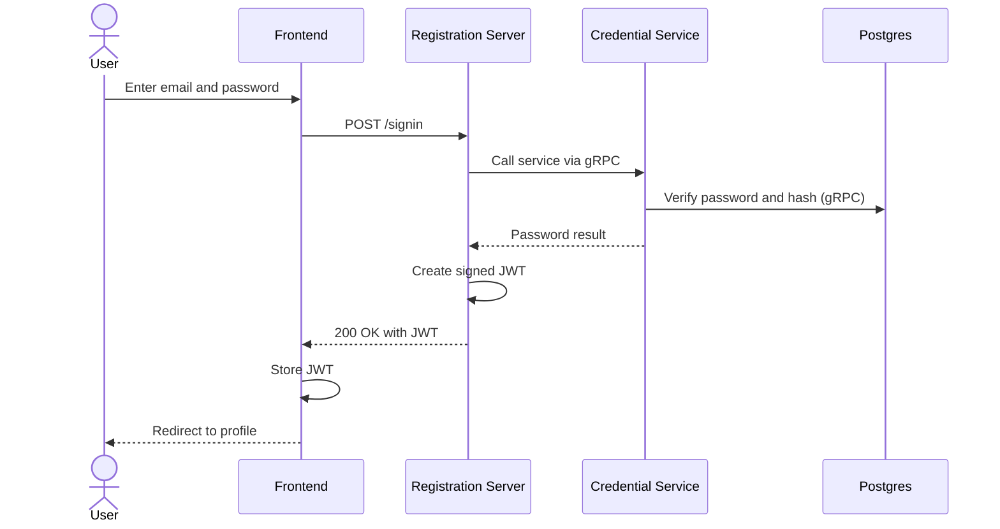
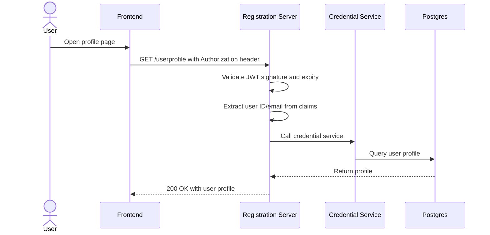

# Specification: Go Registration System

## Overview
- **Purpose:** Create a Sign Up and Sign In system to learn and practice Golang, Temporal Workflow and gRPC.

## Goals
- User signs up with **email** and **password**
- System creates a pending registration and emails a 6-digit code
- User enters the code:
    - correct → account active, success page
    - wrong too many times → registration locked
    - lost / expired → user requests a new code
- Active user logs in, receives an access token, views profile
- Never verified → registration expires after 24h, cleaned up, email can register again

## Architecture

**Component List**
- **Registration Server:** Public HTTP API, UI, prospect lifecycle
- **Credential Service:** Internal gRPC, password hashing + verification
- **Temporal Worker:** Registration workflow, email, expiry

## Use Cases
| |	Use case | Rules |
| --- | --- | --- |
|UC1 | Register	Email + password policy validation.| No account enumeration. |
UC2	| Verify email	| 6-digit OTP, TTL 15m, max 5 attempts | 
UC3	| Resend OTP	| Invalidate previous OTP, rate-limited |
UC4	| Log in	| Active accounts only, JWT/PASETO |
UC5	| Get profile	| Auth middleware |
UC6	| Expire registrations	| Pending > 24h → expired, cleanup|

Prospect status: pending → verified → active / expired / locked

## Technical Design
### List of endpoints:
All endpoints accept and return JSON unless stated otherwise. The profile endpoint
requires a valid access token in the `Authorization` header.

| Method | Path | Authentication | Request body | Success response | Description |
| --- | --- | --- | --- | --- | --- |
| `POST` | `/signup` | None | `{ "email": "string", "password": "string" }` | `201 Created` | Create a pending registration and send an OTP. |
| `POST` | `/signin` | None | `{ "email": "string", "password": "string" }` | `200 OK` | Authenticate an active user and return an access token. |
| `POST` | `/otp/resend` | None | `{ "email": "string" }` | `202 Accepted` | Invalidate the previous OTP and send a new one. |
| `POST` | `/otp/verify` | None | `{ "email": "string", "otp": "string" }` | `200 OK` | Verify the OTP and activate the account. |
| `GET` | `/userprofile` | Bearer token | None | `200 OK` | Return the authenticated user's profile. |

### Database Schema:
Will be added later

## POC Flows

#### Sign up POC flow

#### OTP verification POC flow

#### Resend OTP POC flow

#### Sign in POC flow

#### Get profile POC flow

